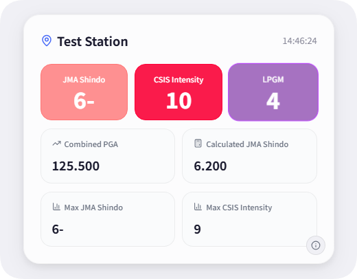
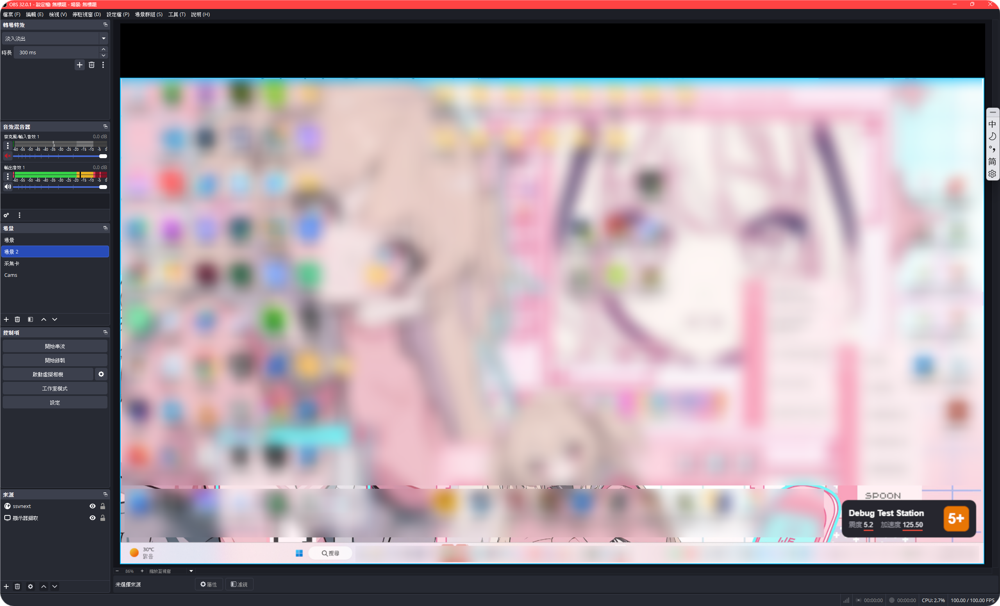

# SSV NEXT


基于 [Wolfx SeisJS API](https://seisjs.wolfx.jp/) 的实时地震观测站数据查看器。

此版本是 [Seismic Stations Viewer (Vue)](https://github.com/realcodestudio/Seismic-Stations-Viewer) 的 Next.js 重写版本。

## 预览

测站卡片（实时徽章 + 数据面板）：



## 功能

- **实时数据**：通过 WebSocket 接收各测站的 PGA / PGV / 计测震度 / 最大震度 / CSIS 烈度 / 长周期地震动等数据
- **双显示模式**：标准测站卡片 / 迷你卡片
- **实时徽章**：JMA 震度、CSIS 烈度直观展示
- **PGA 波形**：使用 PGA 差值绘制参考波形
- **测站详情**：基本信息、当前参数、最大记录、方向分量、系统状态
- **本地调试**：JSON 即时解析渲染，支持示例数据

## 支持与 OBS 直播

使用 **透明** 背景即可轻松将 SSV NEXT 嵌入直播画面。

## 快速开始

```bash
npm install
npm run dev      # 开发：http://localhost:3000
npm run build    # 生产构建
npm start        # 生产运行
```

要求 Node.js 18+。

## 技术栈

| 类别  | 技术                                              |
| --- | ----------------------------------------------- |
| 框架  | Next.js 15 (App Router) + React 19 + TypeScript |
| 状态  | Zustand（persist 中间件本地缓存）                        |
| 图表  | ECharts、Canvas                                  |
| 样式  | CSS Modules + MD3E 设计变量，思源黑体（next/font 自托管）     |
| 数据源 | Wolfx SeisJS WebSocket API                      |

## 自定义 API 地址

设置面板支持更换 WebSocket 地址（`ws://` / `wss://`）。
第三方数据源在结构、字段与推送频率上可能与默认适配的 Wolfx SeisJS API 不一致，由此造成的任何问题与 Wolfx Project 及本项目无关。

## 致谢

- 数据源：[Wolfx Project](https://wolfx.jp/)
- 原项目：[Seismic Stations Viewer (Vue)](https://github.com/realcodestudio/Seismic-Stations-Viewer)


STAR!! PLS!!
